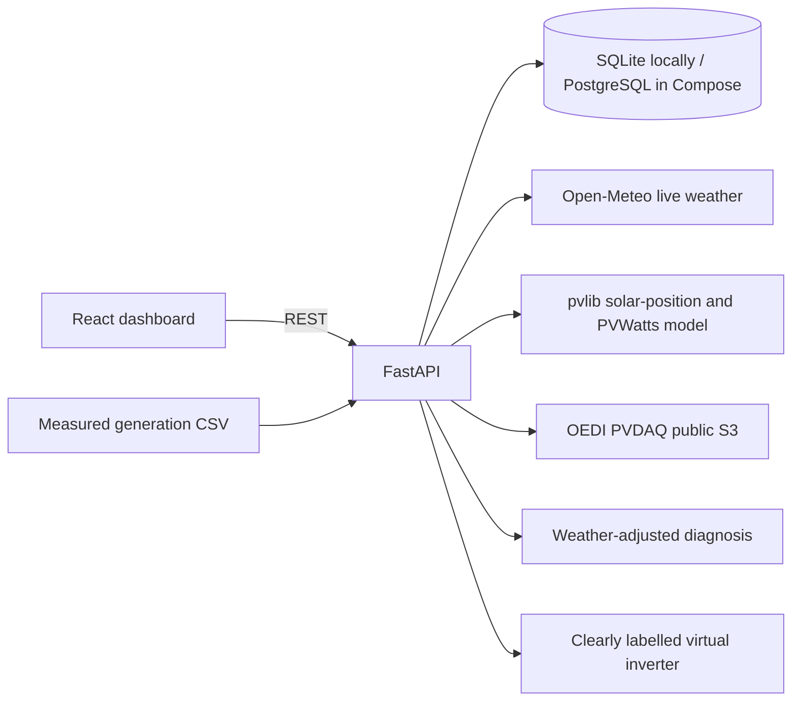

# SolarSense AIoT

Weather-aware solar performance monitoring for a software-only installation. SolarSense combines Open-Meteo weather, a pvlib physics-based solar model, virtual IoT devices and inverter scenarios, stored telemetry, explainable diagnosis, and maintenance guidance.

## What is implemented

- Live current and forecast weather through Open-Meteo, with source and timezone visible.
- Physics based expected power using irradiance, ambient temperature, capacity, configured system losses, and inverter efficiency.
- Persistent installation settings and observations using SQLAlchemy (SQLite for local development; PostgreSQL in Compose).
- City-based installation location lookup using Open-Meteo Geocoding, with region/country choices, six-hour result caching, and automatic coordinate/timezone persistence.
- Local measured CSV training from the four files under `dataset/`, with chronological validation/test and a persisted model artifact and evaluation metrics.
- Measured generation CSV import with size, extension, numeric and timestamp validation.
- Virtual inverter with configurable dust loss; all outputs are labelled simulated.
- Weather-aware performance classes, possible fault detection, monitoring history, and inspection guidance.
- Public PVDAQ object discovery and bounded metadata acquisition from OEDI's anonymous S3 data lake.
- React/TypeScript dashboard with a combined Site & performance page, optional manual or CSV energy entry, dataset readiness, and installation settings.

The included local plant dataset can be evaluated from the Data & Models page. This legacy training pipeline aggregates inverter AC readings by plant interval, joins weather readings, compares regressors with chronological partitions, and saves an optional model artifact. Those artifacts and their metrics do not participate in runtime prediction. Install `backend/requirements-ml.txt` only if you want to train an ML artifact; the active prediction service uses pvlib and does not require an ML artifact. PVDAQ discovery remains a separate bounded metadata acquisition.

## Architecture



## Requirements

- Python 3.11+
- Node.js 20+
- Internet access for Open-Meteo weather. PVDAQ acquisition additionally needs anonymous S3 access.
- Docker and Docker Compose are optional for PostgreSQL deployment.

## Run locally

Backend (SQLite default):

```bash
cd backend
python -m venv .venv
source .venv/bin/activate
pip install -r requirements.txt
uvicorn app.main:app --reload
```

In another terminal:

```bash
cd frontend
npm install
npm run dev
```

Open http://localhost:5173. API docs are at http://localhost:8000/docs and health at `/api/health`.

Location setup is under **Installation**. Search for a city, choose the matching administrative region and country, then save. The backend resolves the selection to coordinates and timezone; the UI does not ask for coordinates.

The **Site & performance** page now includes a software-only simulation control center. Configure panel and inverter values under Installation, choose an operating scenario and sampling interval, then start. The control center advances timestamped virtual panel, environmental, inverter, and gateway readings against Open-Meteo weather. Sessions support pause, resume, stop, reset, and speed controls. Dust accumulation ramps over the selected duration; shading and inverter conditions affect simulated output while the shared prediction service continues to estimate weather-adjusted expected power. Simulated cleaning resets the soiling curve and labels recovery as an estimate. No hardware or MQTT broker is required.

## Docker Compose

From repository root, copy `.env.example` to `.env`, change the development password, then run:

```bash
docker compose up --build
```

Services: dashboard http://localhost:5173, API http://localhost:8000, PostgreSQL on the private Compose network.

## Data and methodology

- **Weather:** Open-Meteo current, forecast, or timestamp-aligned historical weather. GHI and ambient temperature are required; if unavailable, the dashboard reports the prediction as unavailable instead of inventing weather inputs. Missing DNI/DHI are derived with pvlib and disclosed.
- **Expected output:** `pvlib` calculates solar position, Hay-Davies plane-of-array irradiance, SAPM cell temperature, PVWatts DC power, and PVWatts inverter AC power using installation orientation, losses, efficiency, and capacity limits. Expected and simulated actual power are in kW; interval energy is calculated in kWh. The optional saved Random Forest and its metrics remain available on Data & Models but do not affect runtime predictions. See [the model assumptions and equations](docs/PREDICTION_MODEL.md).
- **Actual output:** imported CSV rows are measured data attributed to the uploaded file. Required columns: `timestamp` and one of `actual_kwh`, `energy_kwh`, `generation_kwh`, or `kwh`. Optional headers are not currently joined to weather.
- **Diagnosis:** near-zero output under strong daylight signals a possible system fault; a low expected/actual ratio prompts inspection. The system cannot confirm dirt, shading, or a failed component from weather and production alone.
- **PVDAQ:** OEDI publishes the PVDAQ public data lake as CSV/Parquet objects. Acquisition is intentionally bounded. No model is trained from the metadata sample.
- **Local ML data:** `dataset/Plant_1_Generation_Data.csv`, `Plant_1_Weather_Sensor_Data.csv`, `Plant_2_Generation_Data.csv`, and `Plant_2_Weather_Sensor_Data.csv`. The target is aggregated measured `AC_POWER`; features include measured irradiation and ambient/module temperature plus cyclical time features. Simulated inverter values are excluded.
- **PVGIS:** source is documented in the data registry, but independent API modelling is not yet wired into prediction.

## CSV example

```csv
timestamp,actual_kwh
2026-11-15T10:00:00+05:30,1.42
2026-11-15T11:00:00+05:30,1.87
```

Go to Performance and choose **Import CSV**. The API accepts up to 10 MB and reports accepted and rejected rows.

The combined **Site & performance** page also includes a manual entry form for a timestamp and generated energy in kWh. Both CSV import and manual readings are optional; they are stored with their input source so they remain distinguishable from simulated inverter values.

## API overview

| Method | Path | Purpose |
|---|---|---|
| GET | `/api/health` | API and DB readiness/model status |
| GET/PUT | `/api/installation` | Site and system configuration |
| GET | `/api/locations/search?q=Coimbatore` | Search Open-Meteo city results |
| GET | `/api/weather` | Live Open-Meteo response |
| GET | `/api/overview` | Expected output, latest actual, classification |
| GET | `/api/observations` | Stored history |
| DELETE | `/api/observations` | Reset performance history and derived diagnosis |
| POST | `/api/production/csv` | Import measured generation CSV |
| POST | `/api/production/manual` | Save one measured energy reading in kWh |
| POST | `/api/simulator/run?dust=0.25&fault=false` | Record virtual inverter output |
| GET | `/api/simulation/state` | Current session, virtual devices, and recent telemetry |
| POST | `/api/simulation/start` | Start a timestamped simulation session |
| POST | `/api/simulation/{id}/step` | Generate weather-aligned telemetry and interval production |
| POST | `/api/simulation/{id}/control/{pause\|resume\|stop\|reset}` | Control a session |
| POST | `/api/simulation/{id}/clean` | Simulate cleaning in a dust scenario |
| GET | `/api/devices` | List virtual devices and connectivity |
| POST | `/api/gateway/ingest` | Validate and persist software-gateway telemetry |
| GET | `/api/cleaning-events` | Cleaning and simulated maintenance history |
| GET | `/api/diagnosis` | Recent trend assessment |
| GET | `/api/models/status` | Model readiness and evaluation metrics |
| POST | `/api/models/train` | Train/evaluate and save model from local dataset files |
| GET/POST | `/api/datasets` | Dataset sources and acquisition history |
| POST | `/api/datasets/acquire` | Bounded PVDAQ public-object discovery/acquisition |
| POST | `/api/cleaning-events` | Record user-reported cleaning |

## Storage

`installations` holds site and equipment configuration, including city, administrative region, country, internally resolved coordinates, and timezone. On startup, the service applies additive columns for existing databases without changing saved coordinates. `observations` records expected/actual interval values with source and status. `dataset_runs` stores acquisition outcomes. `cleaning_events` stores user-reported cleaning history. Tables are created automatically on service startup. For production, introduce Alembic migration revisions before evolving schemas.

## Limitations and next steps

The local dataset now provides a trained and evaluated model, but the project is not all of the original brief's acceptance criteria. There is no automated aligned PVDAQ/weather training pipeline, PVGIS prediction call, alert scheduler, SHAP explanation, or Alembic revision history. CSV uploads are interval energy while the virtual inverter and current expected estimate are power; the API labels their units and avoids directly comparing CSV energy against instantaneous power. The local dataset is short and does not contain certified plant capacity metadata, so the learned normalized profile should not be treated as a site-certified forecast.

The PVDAQ source is the current OEDI public data lake, not the decommissioned PVDAQ v3 API. See [OEDI submission 4568](https://data.openei.org/submissions/4568) and [OpenEDI's data lake documentation](https://github.com/openEDI/documentation/blob/main/pvdaq.md).
