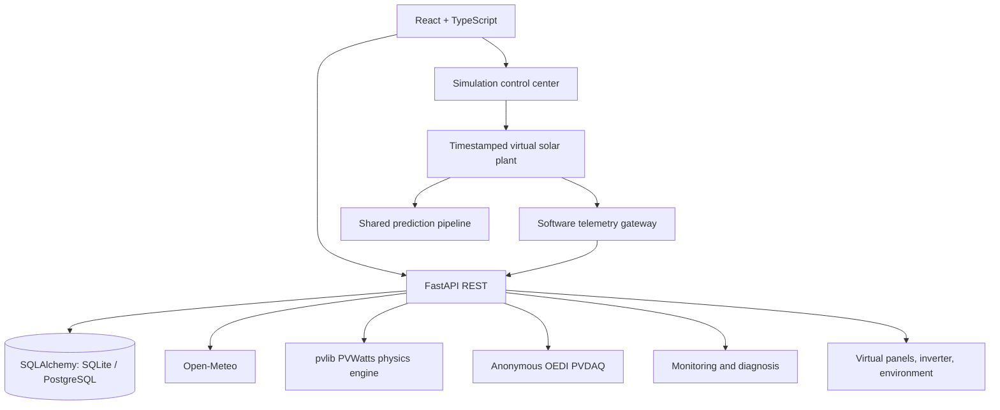

# Architecture

Weather and PVDAQ are external dependencies. Each simulation session stores its configuration, scenario, cursor, and status. Generated device telemetry retains a device ID, installation ID, source, timestamp, measurement, value, unit, and validity flag. Simulated observations keep interval power and energy in separate columns and link back to the session. CSV/manual observations remain separately tagged as measured input. The simulation gateway uses REST; no physical devices or broker are required.
